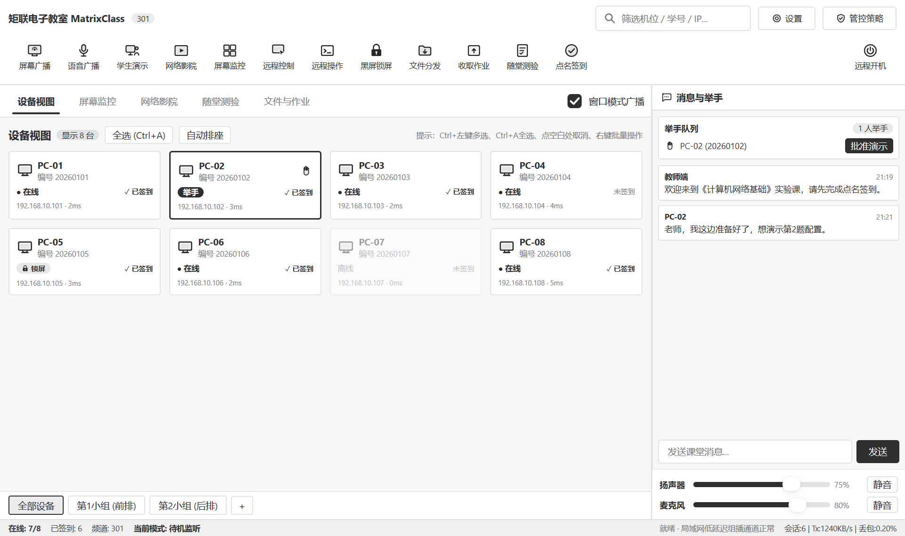
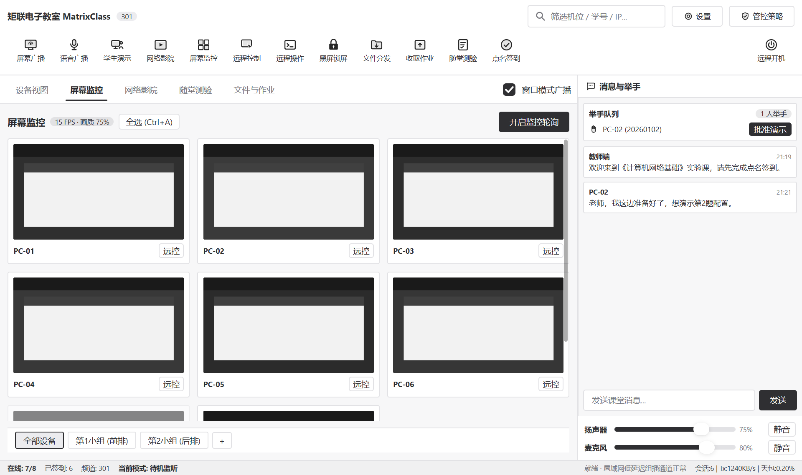
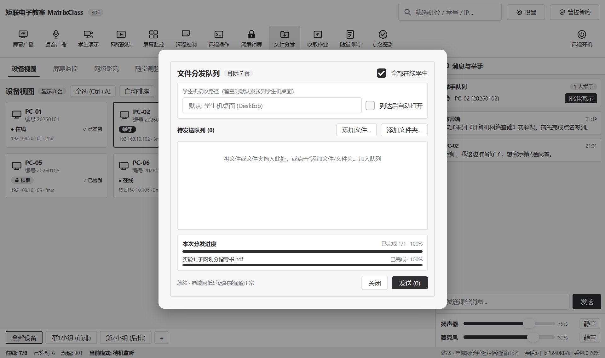
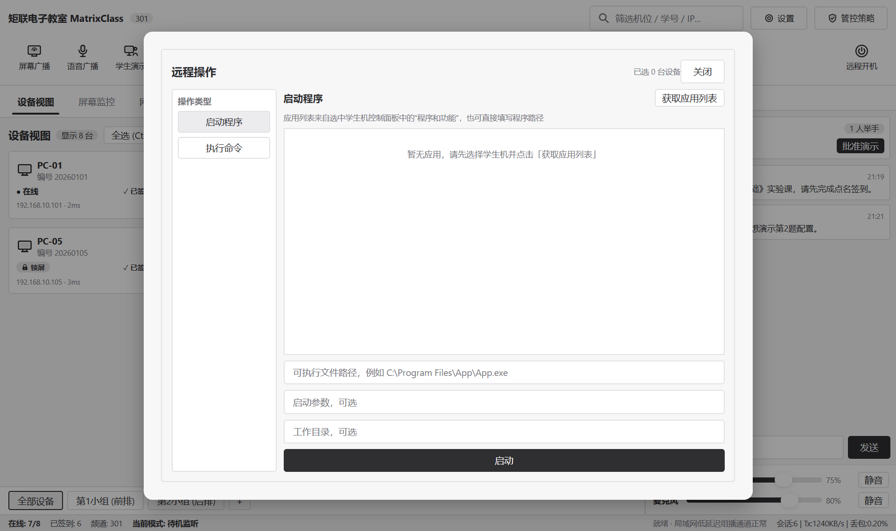
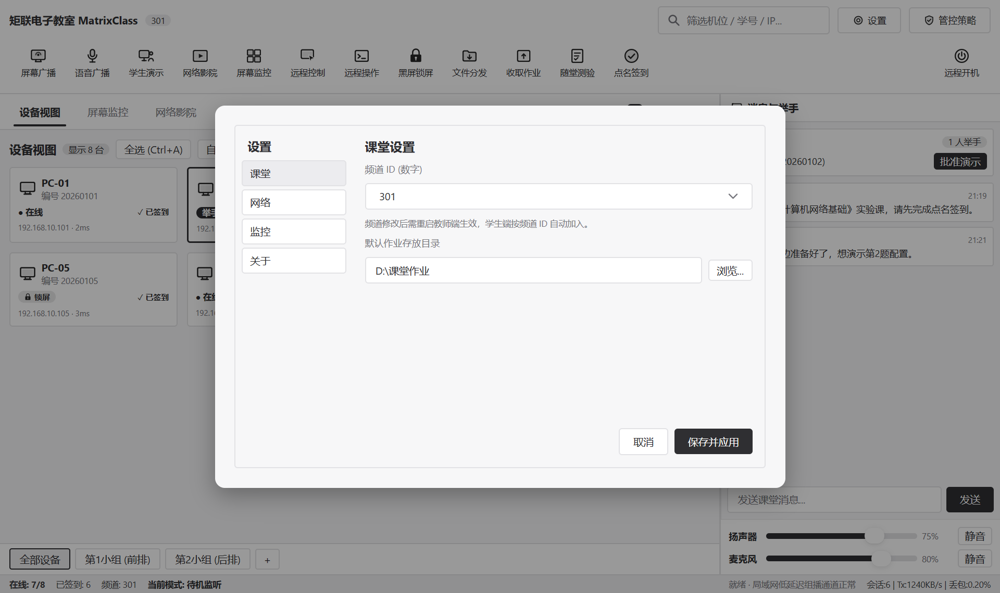
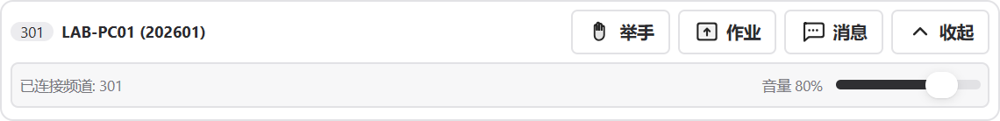
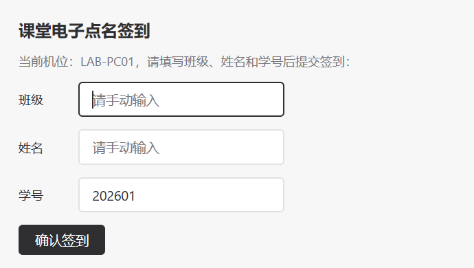
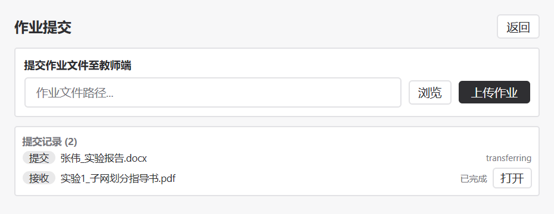
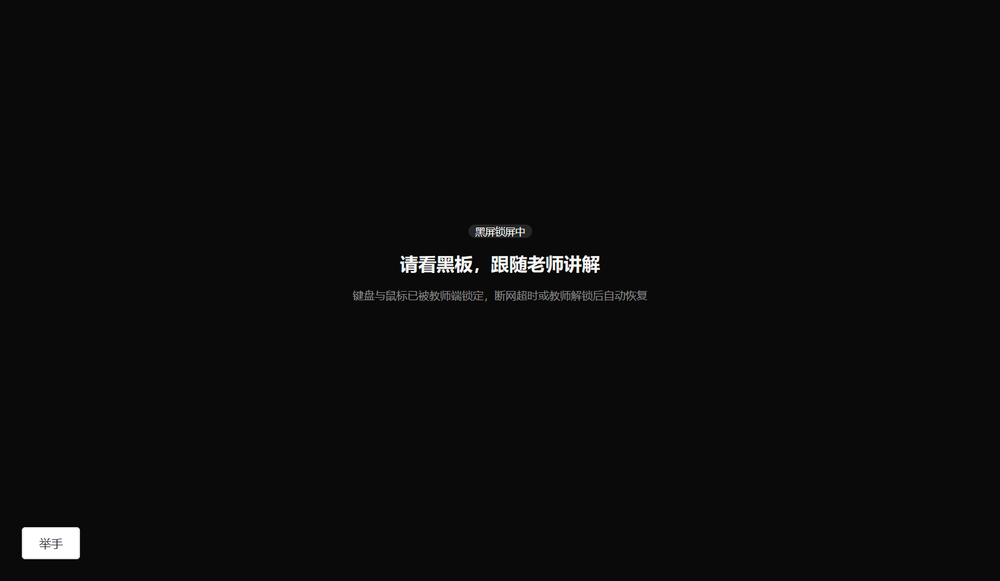

# 矩联电子教室 MatrixClass

矩联电子教室 MatrixClass 是一套面向局域网教室环境的教师端与学生端软件，使用 Go 和 MyGo 原生 UI 开发，采用 KCP/SMUX 进行局域网通信，提供屏幕广播、屏幕监控、课堂消息、文件分发、作业收取、随堂测验、点名签到、远程控制和管控策略等功能。



## 核心优势

### 界面简洁，启动快

- 黑白灰原生界面，常用功能集中在顶部导航栏，没有多余装饰
- 原生 UI 直接绘制，不依赖浏览器内核，程序体积小，打开即用
- 学生端平时只显示一条置顶悬浮条，不打扰课堂操作
- 默认窗口尺寸适中，可手动放大，列表区域均支持滚动

### 防止学生伪装与破解

- **防伪装教师**：教师端持有 Ed25519 身份密钥，发现广播和连接握手都带签名；学生端固定信任教师指纹，同网段其他人伪装成教师无法接管学生机
- **通信加密**：X25519 密钥交换 + AES-256-GCM 会话加密，组播画面使用每次会话独立密钥，抓包无法查看或篡改内容
- **退出受密码保护**：学生端退出、卸载、进入参数设置都需要首次安装时设置的密码，关闭窗口不能退出
- **锁屏难绕过**：黑屏锁屏时拦截系统快捷键，解锁入口默认隐藏，只有输入学生端密码才能本地解锁
- **教师端可重置**：学生忘记或被篡改的密码可由教师端远程重置

### 连接快，丢包少

- 基于 KCP 可靠 UDP 协议，重传更快，局域网内延迟明显低于普通 TCP
- SMUX 多路复用，画面、消息、文件共用一条连接，互不阻塞
- 屏幕广播走组播 + Reed-Solomon 前向纠错，少量丢包可直接恢复，无需重传
- 频道 ID 自动发现教师端，支持多网卡监听，断线后自动持续重连
- 文件分发支持断点续传和失败重试，大文件和文件夹也能稳定送达

## 界面预览

### 教师端

| 屏幕监控 | 文件分发 |
| --- | --- |
|  |  |
| **远程操作** | **设置** |
|  |  |

### 学生端

**课堂悬浮条**：平时置顶在屏幕顶部，自动收起，鼠标靠近时展开。



| 点名签到 | 作业提交 |
| --- | --- |
|  |  |

**黑屏锁屏**：左下角可举手，连点五下中间文字才会出现密码解锁入口。



## 项目结构

```text
cmd/teacher        教师端程序
cmd/student        学生端程序
internal/core      核心接口和领域模型
internal/media     屏幕、音频、视频编码和录课
internal/transport KCP、SMUX、发现和重连
internal/filetransfer 文件分发和作业传输
internal/control   远程输入、锁屏、进程和网络策略
internal/ui        教师端、学生端和演示界面
packaging          Windows、Linux、macOS 发布文件
scripts            构建、打包和验证脚本
third_party/mygo   项目使用的 MyGo 本地副本
tools              构建辅助工具
```

工作区目录：`repo/` 存放源码，`release/` 存放发行包，`doc/` 存放文档，`other/` 存放临时验证产物。

## 主要功能

### 教师端

- 数字频道 ID 和教师账号登录
- 设备视图、屏幕监控、分组管理和批量操作
- 屏幕广播、监控画质和帧率设置
- 课堂消息、点名签到和随堂测验发布
- 文件及文件夹分发，显示进度并支持重试
- 作业收取、保存目录选择和提交结果查看
- 远程打开学生端控制面板程序
- 按路径启动程序，执行 CMD 或 PowerShell 命令
- 远程控制、锁屏、扬声器和麦克风音量控制
- 管控策略编排、下发和撤销
- SQLite 持久化教师端配置和课堂数据

### 学生端

- 安装完成后自动启动
- 首次启动设置退出密码和数字频道 ID
- 断线后持续自动重连并显示连接状态
- 托盘参数设置需要退出密码验证
- 接收屏幕广播、课堂消息、文件和随堂测验
- 教师发起签到时弹出独立窗口，手动填写班级和姓名
- 教师发起收取作业时弹出独立提交窗口
- 文件接收队列显示下载进度并支持失败重试
- 退出和卸载学生端需要密码验证

## 技术栈

- **语言**：Go
- **界面**：MyGo 原生 UI，构建标签为 `nexlab_nowebview`
- **网络**：KCP ARQ、SMUX、UDP 广播发现、组播和 KCP 回退
- **安全**：Ed25519 教师身份签名、X25519 密钥交换、AES-256-GCM 会话加密
- **视频**：屏幕采集、Tile-Delta/Zstd 和平台硬件编码
- **音频**：Windows WASAPI、Linux PipeWire/PulseAudio、macOS CoreAudio
- **数据**：SQLite
- **录课**：`.nxlr` 课堂录制格式
- **平台**：Windows amd64/arm64、Linux amd64/arm64/loong64、macOS amd64/arm64

## 本地开发

以下命令均在 `repo` 目录执行。需要 Go `1.27.3` 或兼容版本；Windows 构建 NSIS 安装包需要 `makensis.exe`。

### 测试

```powershell
go test -tags nexlab_nowebview -count=1 ./...
```

Linux CI 没有真实桌面、音频设备或 PipeWire/PulseAudio 时，测试会根据环境能力跳过硬件依赖部分，但仍执行协议、编码、传输和业务逻辑测试。

### Windows 构建和演示

```powershell
New-Item -ItemType Directory -Force dist | Out-Null
go build -tags nexlab_nowebview -ldflags "-H windowsgui" -o dist\matrixclass-teacher.exe .\cmd\teacher
go build -tags nexlab_nowebview -ldflags "-H windowsgui" -o dist\matrixclass-student.exe .\cmd\student

dist\matrixclass-teacher.exe --demo
dist\matrixclass-student.exe --demo
```

### Linux 构建

```powershell
.\scripts\build-linux.ps1
.\scripts\build-linux-package.ps1
```

默认生成 Linux `amd64`、`arm64` 和 `loong64` 二进制及 tar.gz 包。发行版包可在 Linux 主机或已配置 WSL 的 Windows 主机中生成：

```powershell
.\scripts\build-linux-distro-packages.ps1 -OutputDir dist\linux -Architecture amd64
```

### macOS 构建

```powershell
.\scripts\build-darwin.ps1
.\scripts\build-darwin-package.ps1
```

构建脚本会生成 Intel、Apple Silicon 和 Universal 2 二进制。未签名版本需要在 macOS 上处理系统安全提示和隐私权限。

### 全平台发行构建

```powershell
.\scripts\build-all.ps1 -Version 0.1.0
```

发行结果位于 `dist/release`，同时生成 `SHA256SUMS.txt`。Windows 发行包包含教师端和学生端独立 NSIS 安装程序；学生端安装成功后自动启动。`-IncludeCompileOnly` 可额外生成仅编译验证目标，这些目标不属于正式发布平台。

## 平台能力说明

Linux 支持 KCP/SMUX 网络、文件传输、课堂消息、Linux Shell 远程命令、XDG `.desktop` 应用列表、X11 屏幕采集、X11 远程输入和桌面锁定。

- X11 屏幕采集和远程输入需要 `DISPLAY`、`libX11.so.6` 和 `libXtst.so.6`。
- Wayland 会明确提示需要桌面授权，不伪造为无授权屏幕采集。
- 音频功能需要 PipeWire 或 PulseAudio 命令及对应设备。
- 局域网发现可能需要开放 UDP 广播/组播和 KCP 监听端口。
- LoongArch64 已纳入构建目标，但仍应在真实龙芯 Linux 桌面环境验证 UI、屏幕采集和音频能力。

macOS Intel 和 Apple Silicon 均提供构建目标，Universal 2 包同时包含 `amd64` 与 `arm64`。屏幕录制、麦克风、辅助功能和远程输入必须在系统设置中授权。没有 Apple Developer 证书时生成的应用和 DMG 不带 Apple 签名与公证。

## 教师身份与通信安全

同一网段里，任何人都可能运行一个教师端。为防止冒充的教师端控制学生机：

- 教师端首次启动时，在数据目录生成 Ed25519 身份密钥 `teacher-identity.key`。指纹显示在「设置 → 网络」和「关于」页。
- 教师端对发现广播签名；每个学生连接都要先完成握手，由教师端用身份密钥签名。之后控制、媒体和文件流量全部用 AES-256-GCM 加密。组播画面使用每次启动随机生成的密钥，只通过已认证的通道下发。
- 学生端默认信任首次连接的教师端（TOFU），并把指纹保存到数据目录的 `trusted-teacher.txt`。之后只接受这个指纹签名的教师端。
- 在共享网络里，建议预先固定指纹：首次设置界面或「参数设置」里填写教师端指纹，或批量部署时使用 `student -teacher-fingerprint XXXX-...`。
- 多台教师机共管同一课堂时，把 `teacher-identity.key` 复制到其他教师机。更换密钥后，需在学生端参数设置中清空或更新指纹。

注意：密钥文件等同于课堂控制权，请勿外传。学生端以普通用户身份运行时，仍可能被拥有本机管理员权限的人修改信任文件。

## CI 与 Pull Request

GitHub Actions 在 push 到 `main` 和创建或更新 Pull Request 时运行：

- Go 全量测试
- Linux `amd64`、`arm64`、`loong64` 构建
- Windows `amd64`、`arm64` 构建
- macOS `amd64`、`arm64` 构建

汇总检查名称为 `CI / test-and-build`。仓库管理员应在 GitHub 分支保护规则中将该检查设置为必需，并禁止未通过检查的 Pull Request 合并。

## 发布目录

源码仓库只提交源代码、构建脚本和必要资源。发行包放在工作区根目录的 `release/`，适配计划和测试矩阵放在 `doc/`，临时构建产物放在 `other/`，避免把大体积二进制和本地验证文件提交到 Git。
